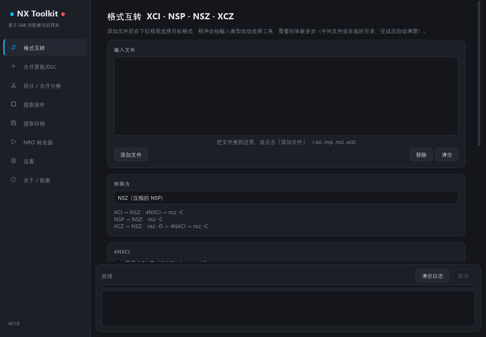
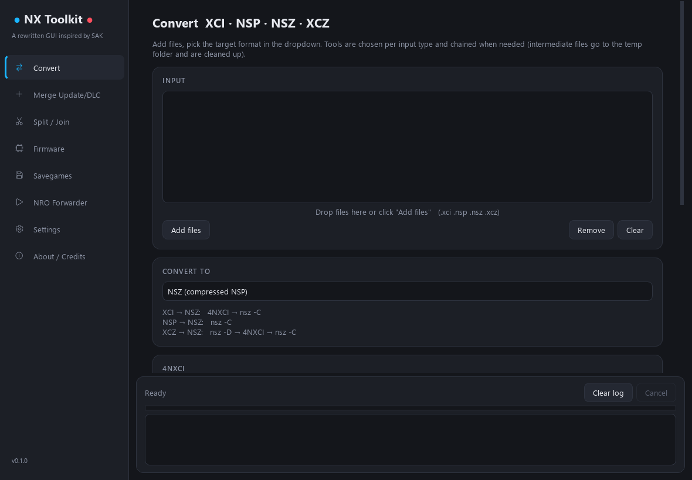

# NX Toolkit

**中文** | [English](#english)

一个深色主题、支持中英文界面的 Nintendo Switch 文件处理图形工具（Windows）。
功能划分参考了 [Switch Army Knife (SAK)](https://github.com/dezem/SAK)（作者 kempa / dezem），
但界面代码完全重新编写，**没有使用 SAK 的程序代码**。实际的文件处理由各开源命令行工具完成，本程序只是它们的图形前端。



## 功能

| 页面 | 说明 | 使用的工具 |
|---|---|---|
| 格式互转 | XCI / NSP / NSZ / XCZ 任意互转，在下拉框里选择目标格式；需要时自动串联多步（例如 XCZ→NSP = 解压 → 4NXCI），并在日志里逐步提示 | 4NXCI、NSC_BUILDER、nsz |
| 合并更新 / DLC | 把本体、更新、DLC 合并为一个 XCI 或 NSP；NSZ/XCZ 会先自动解压 | NSC_BUILDER、nsz |
| 拆分 / 合并分卷 | FAT32 分卷：NSP → 带存档属性的文件夹 `00, 01…`；XCI → `.xc0, .xc1…`，也能合并回来 | 纯 Python |
| 提取固件 | 提取 XCI 的 update 分区，并识别固件版本 | hactoolnet |
| 提取存档 | 解包从 USER 分区复制出来的存档文件 | hactoolnet |
| NRO 转发器 | 生成在主页显示图标、启动 SD 卡上 NRO 的 NSP；可从 NRO 自动读取名称、版本和图标 | hacBrewPack、nx-hbloader |

其他特点：
- 拖放添加文件，多个任务排队执行，可随时取消
- 根据文件名里的 Title ID 识别本体、更新包和 DLC，避免把单独的更新包做成 XCI 之类的错误操作，并给出替代方案
- 合并 / 转换后自动把输出文件名统一为游戏的英文标题（从游戏数据中读取，可在「设置」里关闭）
- 合并 / 转换后自动做完整性检查：如果文件目录没有登记全部数据（squirrel 用已合并的 XCI 再加 DLC 时可能出现），会给出警告并把任务标为失败
- 每个任务使用独立的临时文件夹，结束后（无论成功、失败还是取消）自动删除
- 日志同时写入 `logs/nx-toolkit.log`，便于排查问题
- 设置页可一键下载 / 更新工具，并检查本程序是否有新版本
- 排查问题：命令行运行 `NX-Toolkit.exe --selftest` 可查看工具、密钥的查找结果

## 使用

1. 从 [Releases](../../releases) 下载 `NX-Toolkit-*-win64.zip` 并解压。
2. **准备命令行工具**：首次启动时如果找不到工具，程序会询问是否**一键下载**。工具来自原版 SAK 的 GitHub 发布包（约 28 MB，不含密钥），存放在程序目录下的 `tools` 文件夹；之后也可以在「设置 → 工具下载与更新」里重新下载或检查更新。
   程序也会自动查找已有的工具：程序目录下的 `tools` 或 `bin`，以及程序所在目录和上级目录里的 `SAK_64bit\bin`。还可以在「设置」里手动指定任意包含 `hactoolnet.exe`、`4nxci.exe`、`squirrel.exe`、`hacbrewpack.exe`（转发器另需 `nro_fw_main`、`nro_fw_main.npdm`）的目录。
3. **准备密钥**：在「设置」里指定 `prod.keys`。请使用从你**自己的主机**导出的密钥，本项目不提供任何密钥。
4. 运行 `NX-Toolkit.exe`。

## 从源码运行 / 打包

需要 Python 3.11+。

```bash
python -m venv .venv
.venv\Scripts\pip install -r requirements.txt
.venv\Scripts\python app.py
```

打包 exe：安装 `pyinstaller` 后运行 `build.bat`，结果在 `dist\NX-Toolkit\`。

## 致谢

| 项目 | 作者 | 用途 |
|---|---|---|
| [SAK](https://github.com/dezem/SAK) | kempa / dezem | 功能与流程的灵感来源 |
| [4NXCI](https://github.com/The-4n/4NXCI) | The-4n、SciresM | XCI → NSP |
| [hacBrewPack / hptnacp](https://github.com/The-4n/hacBrewPack) | The-4n | 转发器 NSP 打包 |
| [nx-hbloader](https://github.com/switchbrew/nx-hbloader) | switchbrew；转发器分支来自 R-YaTian、HookedBehemoth、dezem | 转发器程序 |
| [NSC_BUILDER](https://github.com/julesontheroad/NSC_BUILDER) | julesontheroad | NSP → XCI、多内容合并 |
| [LibHac / hactoolnet](https://github.com/Thealexbarney/LibHac) | Thealexbarney | 固件、存档提取 |
| [hactool](https://github.com/SciresM/hactool) | SciresM | NCA 工具 |
| [nsz](https://github.com/nicoboss/nsz) | nicoboss、blawar | NSZ / XCZ 压缩解压 |
| [PySide6](https://doc.qt.io/qtforpython/) | The Qt Company | 界面框架（LGPL） |

各工具的版权和许可证归其作者所有。

## 许可证

NX Toolkit 的源代码采用 [MIT 许可证](LICENSE)。打包的 exe 内置的第三方库（PySide6/Qt、nsz、py7zr 等）各自适用其原有许可证，完整清单见 [THIRD_PARTY_LICENSES.md](THIRD_PARTY_LICENSES.md)，许可证原文随 exe 放在 `licenses\` 文件夹中。外部命令行工具不随本程序分发，适用其作者的许可证。

## 免责声明

本项目与任天堂（Nintendo）及上述各工具的作者均无关联。本项目不包含、也不提供任何密钥、固件或游戏文件。请只处理你合法拥有的内容，并遵守所在地区的法律。

---

<a id="english"></a>

# NX Toolkit (English)

[中文](#nx-toolkit) | **English**

A dark-themed Nintendo Switch file toolkit for Windows with a Chinese / English interface.
Its feature set follows [Switch Army Knife (SAK)](https://github.com/dezem/SAK) by kempa / dezem,
but the GUI is a complete rewrite and **contains none of SAK's code**. The actual file processing is done by open-source command-line tools; this program is a graphical front-end for them.



## Features

| Page | What it does | Tools used |
|---|---|---|
| Convert | Any-to-any between XCI / NSP / NSZ / XCZ, target picked from a dropdown; chains steps when needed (e.g. XCZ→NSP = decompress → 4NXCI) and logs each step | 4NXCI, NSC_BUILDER, nsz |
| Merge Update / DLC | Merge base game, update and DLC into one XCI or NSP; NSZ/XCZ inputs are decompressed first | NSC_BUILDER, nsz |
| Split / Join | FAT32 splitting: NSP → archive-bit folder `00, 01…`; XCI → `.xc0, .xc1…`; and joining back | pure Python |
| Firmware | Extract the XCI update partition and identify the firmware version | hactoolnet |
| Savegames | Unpack save files copied from the USER partition | hactoolnet |
| NRO Forwarder | Build an NSP that shows a home-menu icon and launches an NRO from the SD card; can read title, version and icon from the NRO | hacBrewPack, nx-hbloader |

Also:
- Drag-and-drop input, queued tasks, cancel at any time
- Detects base / update / DLC from the title ID in the file name, blocks impossible operations (such as turning a lone update into an XCI) and suggests alternatives
- Merge / convert outputs are renamed to the game's English title (read from the game data; can be turned off in Settings)
- Integrity check after merge / convert: if the file index does not cover all data (squirrel can produce this when adding DLC to an already merged XCI), the task is flagged as failed with a warning
- Every task uses its own temp folder, deleted when the task ends (success, failure or cancel)
- The log is also written to `logs/nx-toolkit.log` for troubleshooting
- One-click tool download / update and app update check in Settings
- Troubleshooting: run `NX-Toolkit.exe --selftest` to see where tools and keys are found

## Usage

1. Download `NX-Toolkit-*-win64.zip` from [Releases](../../releases) and unzip it.
2. **Command-line tools**: if they are missing on first start, the program offers a **one-click download** from the original SAK release on GitHub (about 28 MB, no keys) into the `tools` folder next to the program. You can re-download or check for updates later under Settings → Tools download & update.
   Existing tools are also found automatically: `tools` or `bin` next to the program, or `SAK_64bit\bin` in the program folder or any parent folder. You can also point Settings to any folder containing `hactoolnet.exe`, `4nxci.exe`, `squirrel.exe`, `hacbrewpack.exe` (plus `nro_fw_main` and `nro_fw_main.npdm` for forwarders).
3. **Keys**: set `prod.keys` in Settings. Use keys dumped from **your own console**; this project provides no keys.
4. Run `NX-Toolkit.exe`.

## Run from source / build

Requires Python 3.11+.

```bash
python -m venv .venv
.venv\Scripts\pip install -r requirements.txt
.venv\Scripts\python app.py
```

To build the exe, install `pyinstaller` and run `build.bat`; the result is in `dist\NX-Toolkit\`.

## Credits

| Project | Authors | Used for |
|---|---|---|
| [SAK](https://github.com/dezem/SAK) | kempa / dezem | Inspiration for features and workflow |
| [4NXCI](https://github.com/The-4n/4NXCI) | The-4n, SciresM | XCI → NSP |
| [hacBrewPack / hptnacp](https://github.com/The-4n/hacBrewPack) | The-4n | Forwarder NSP packing |
| [nx-hbloader](https://github.com/switchbrew/nx-hbloader) | switchbrew; forwarder forks by R-YaTian, HookedBehemoth, dezem | Forwarder executable |
| [NSC_BUILDER](https://github.com/julesontheroad/NSC_BUILDER) | julesontheroad | NSP → XCI, multi-content merge |
| [LibHac / hactoolnet](https://github.com/Thealexbarney/LibHac) | Thealexbarney | Firmware & save extraction |
| [hactool](https://github.com/SciresM/hactool) | SciresM | NCA tooling |
| [nsz](https://github.com/nicoboss/nsz) | nicoboss, blawar | NSZ / XCZ compression |
| [PySide6](https://doc.qt.io/qtforpython/) | The Qt Company | GUI framework (LGPL) |

Each tool belongs to its authors under its own license.

## License

NX Toolkit's source code is released under the [MIT License](LICENSE). Third-party libraries bundled in the exe (PySide6/Qt, nsz, py7zr, …) remain under their own licenses; see [THIRD_PARTY_LICENSES.md](THIRD_PARTY_LICENSES.md) for the full list, and the `licenses\` folder next to the exe for the license texts. The external command-line tools are not distributed with this program and are covered by their authors' licenses.

## Disclaimer

This project is not affiliated with Nintendo or with the authors of the tools above. It contains and distributes no keys, firmware or game files. Only process content you legally own and follow the laws of your country.
